<p align="center">
  <a href="https://github.com/rumij/WatchAlert">
    </a>
</p>

<p align="center">
  <b>🌐 WatchAlert Zabbix 特别版 —— 支持 Zabbix API 轮询的告警中心</b>
</p>

## 本版本说明

**这是专门增加 Zabbix 支持的 WatchAlert 特别版本。** 本仓库基于 [w8t-io/WatchAlert](https://github.com/w8t-io/WatchAlert) 改造，保留原有告警处理能力，增加 Zabbix 数据源、问题事件同步和恢复处理，面向使用 Zabbix 的监控环境。本版本由本仓库维护，不属于上游官方发布版本。

本版通过 **Zabbix JSON-RPC API 主动轮询**接入告警，无需在 Zabbix 中配置向 WatchAlert 发送告警的 Webhook：

- 同步 Zabbix 当前触发器问题到 WatchAlert 故障中心，并补充主机、触发器和标签信息。
- 通过事件同步水位和重叠时间窗口补偿漏采事件，按稳定指纹去重。
- 同步问题恢复及恢复时间，将 Zabbix 严重级别映射为 WatchAlert 的 `P0/P1/P2`。
- 使用只读 Zabbix API Token，并通过 WatchAlert 现有通知渠道发送告警和恢复通知。

接入方法见 [Zabbix API 轮询接入说明](docs/zabbix-api-polling.md)，离线部署流程见 [Zabbix 特别版离线部署手册](docs/WatchAlert-Zabbix-离线部署手册.md)。

本仓库包含特别版后端及 `web/` 配套前端，支持单条、勾选多条、设备和设备组范围的自选时间静默，并修复多条问题共用恢复事件时的恢复同步遗漏。前后端须成对升级，见 [容器升级与回滚方案](docs/container-upgrade-20261010.md)。实际密码、API Token 和运行数据不随源码发布。

以下徽章展示上游项目信息。

<p align="center">
<a href="https://github.com/w8t-io/WatchAlert/graphs/contributors">
  </a>


<a href="LICENSE"></a>

## 💎 WatchAlert 是什么？
🎯 **专注可观测性与稳定性，为运维提效降本**

WatchAlert 是一款专为云原生环境设计 的轻量级监控告警引擎，聚焦于可观测性（Metrics、Logs、Traces）与系统稳定性保障，提供从采集、分析到告警的全链路解决方案 。

🔍 **AI 智能加持，让告警更有"洞察力"**

通过 AI 技术深度分析 Metrics、Logs 和 Traces 中的异常信号，精准定位根因，智能生成排查建议与修复方案，显著提升故障响应效率。

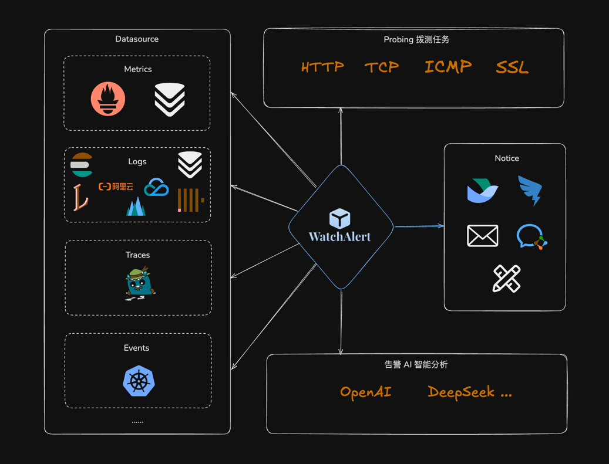

## 🧩 全面兼容主流可观测技术栈

|  监控类型   | 支持的数据源                                                                                    |
|:-------:|-------------------------------------------------------------------------------------------|
| Metrics | Prometheus.                                                                        |
| Logs   | Loki、ElasticSearch、VictoriaLogs、ClickHouse、SLS（阿里云日志服务）、TLS（火山云日志服务，开发中）、CLS（腾讯云日志服务，开发中） |
| Traces  | Jaeger                                                                                    |
| Events  | Kubernetes 事件监控                                                                           |
| Zabbix 告警 | Zabbix JSON-RPC API：触发器问题轮询、事件补偿和恢复同步（本特别版扩展） |
| 网络拨测 | HTTP、ICMP、TCP、SSL                                                                         |
| 通知渠道 | 飞书、钉钉、企业微信、邮件、自定义 Webhook、Slack                                                           |


## 🔍 核心亮点

🔗 **Zabbix 专项支持（特别版扩展）**

- 将 Zabbix 问题事件接入统一故障中心，复用 WatchAlert 的通知、值班和告警升级能力。
- 支持配置轮询间隔、首次回溯窗口和严重级别映射，并提供 Zabbix 同步状态查询。

🧠 **AI 智能分析**

- 基于 AI 技术对告警内容进行深度语义解析，自动识别异常模式
- 提供根因推测、排查建议与修复思路，让每一次告警都"言之有物"

🕰️ **完善的值班机制**
- 支持轮班排班、节假日调整、值班交接等场景
- 告警通知精准匹配责任人，确保第一时间响应

⚡ **告警升级机制**
- 多级告警策略配置：从首次触发到升级通知，层层保障不漏报
- 支持超时重试、通知升级、负责人转接等功能，保障告警闭环处理

📊 **Namespace 级告警分类**
- 支持以命名空间（Namespace）为单位进行告警分组管理
- 清晰分类，快速定位，大幅提升故障处理效率

## 🚀 技术栈
- 后端环境要求
  - Go >= `1.23`

  - `Go`、`Gin`、`Viper` 、`Gorm`、`JWT`、`Go-zero`...

- 前端环境要求
  - Node.js >= `v18.20.3`
  - Yarn >= `1.22.22`
  - `React`、`JSX`、`Ant-design`、`Codemirror`...

## 📚 项目文档

- Zabbix 特别版接入：[docs/zabbix-api-polling.md](docs/zabbix-api-polling.md)
- Zabbix 特别版离线部署：[docs/WatchAlert-Zabbix-离线部署手册.md](docs/WatchAlert-Zabbix-离线部署手册.md)
- 上游功能介绍：https://cairry.github.io/docs/
- 上游通用部署参考：https://cairry.github.io/docs/install/docker.html


## 🎉 项目预览

| 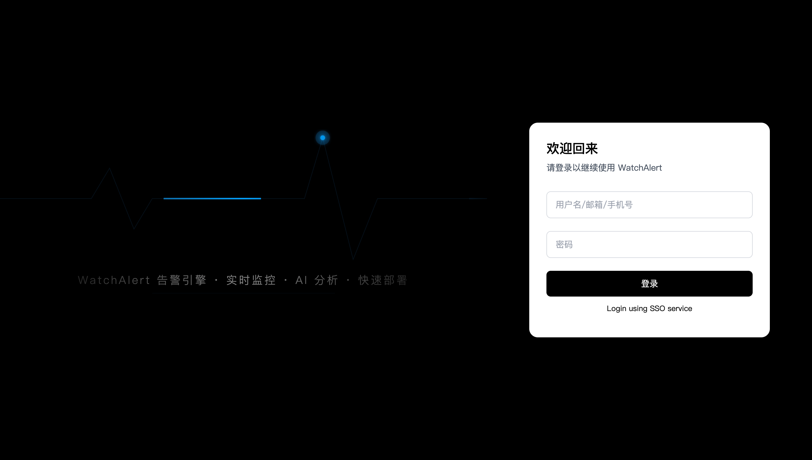 | 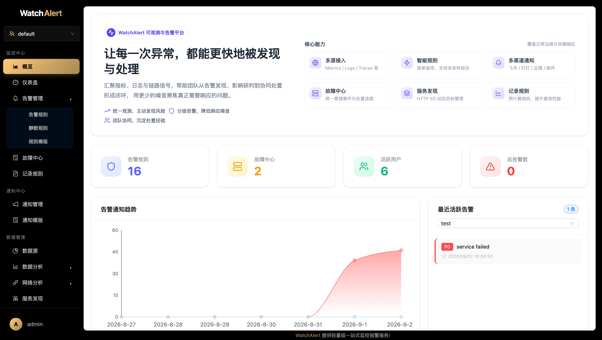            |
|:--------------------------:|------------------------------|
|    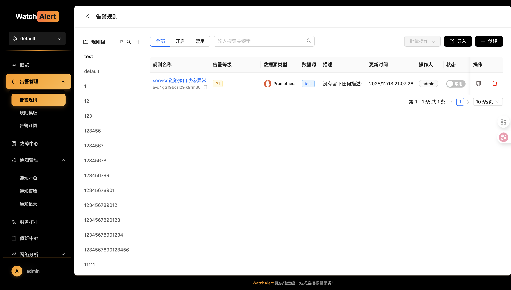     | 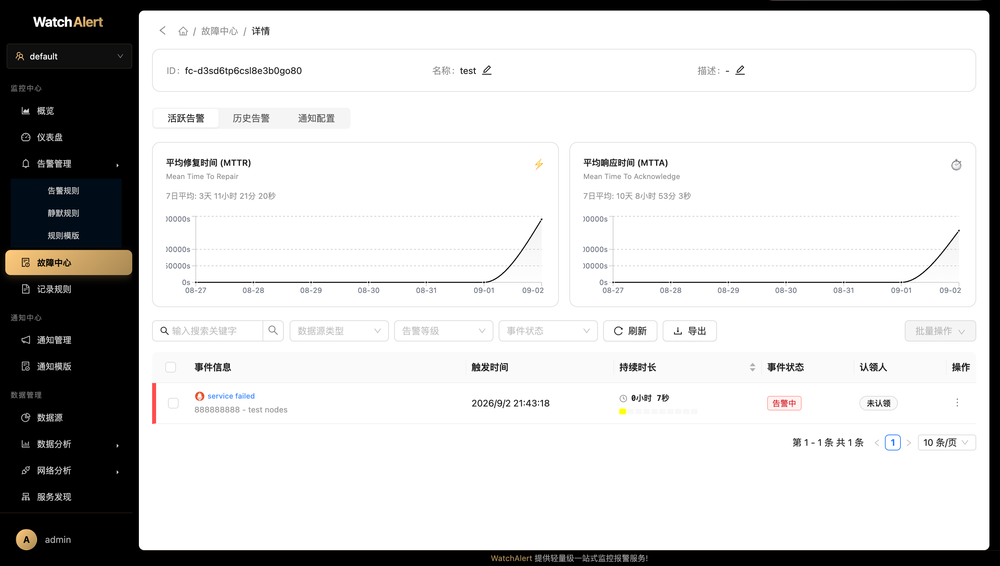  |
|   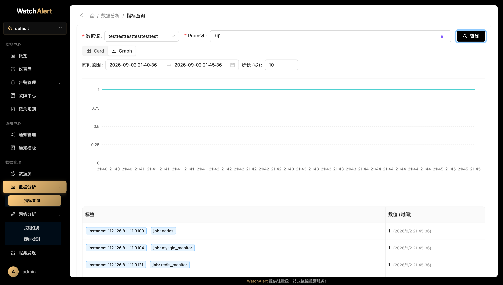    | 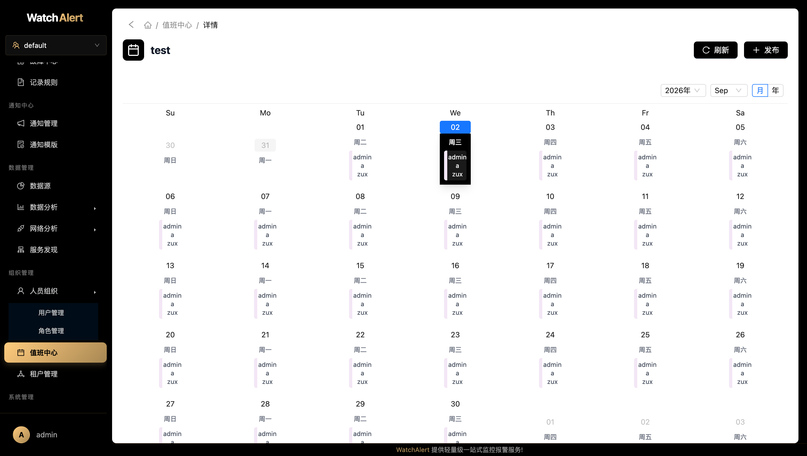           |
|  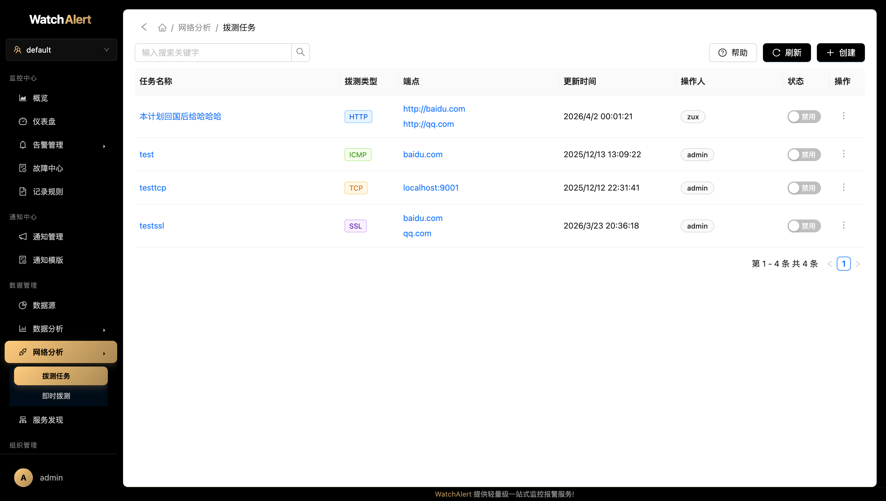   | 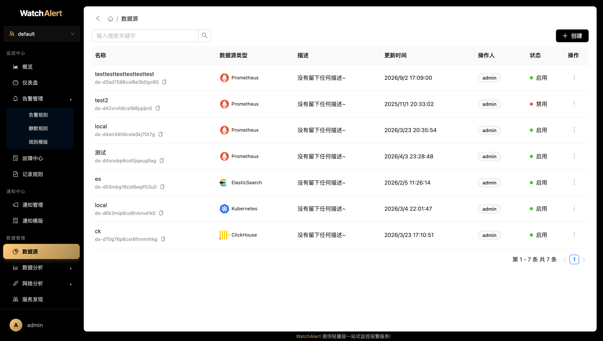|
|   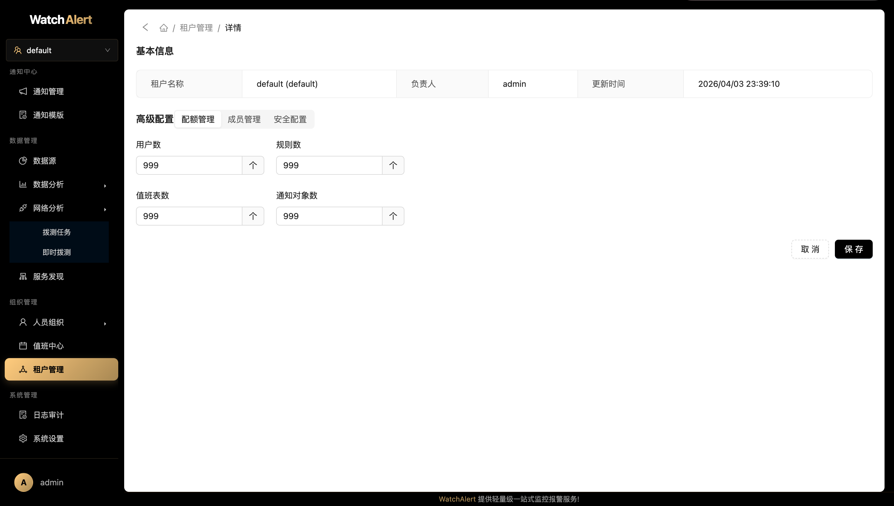      | 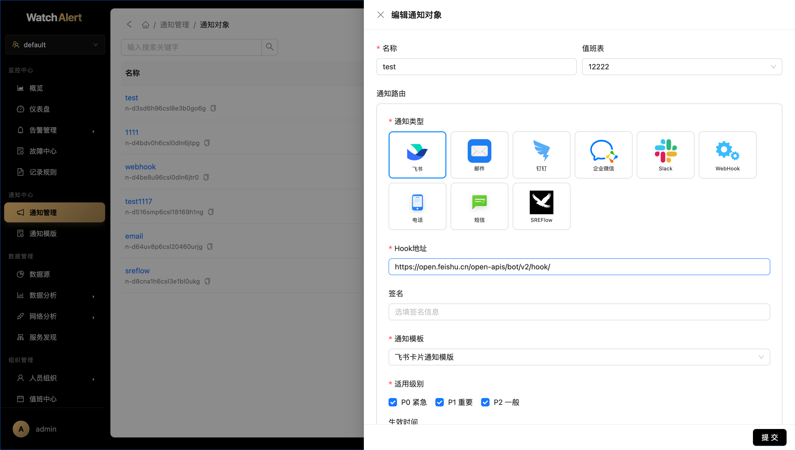             |

## 🏆 感谢赞助者

- [前往查看](./sponsors-alternative.md)
- 欢迎通过项目顶部的 "**Sponsor**" 按钮支持我们！

## 🎸 支持
- 如果你觉得 WatchAlert 还不错，可以通过 Star 来表示你的喜欢
- 在公司或个人项目中使用 WatchAlert，并帮忙推广给伙伴使用

## 🧑‍💻 交流渠道
- [点击我](https://cairry.github.io/docs/#%E4%BA%A4%E6%B5%81%E7%BE%A4-%E8%81%94%E7%B3%BB%E6%88%91)

## 本地配置与凭据

本仓库保存支持 Zabbix 的特别版后端源码，基于 [w8t-io/WatchAlert](https://github.com/w8t-io/WatchAlert) 修改，保留原项目许可证。前端和离线镜像包不包含在本仓库。

首次运行前复制配置模板：

```bash
cp config/config.example.yaml config/config.yaml
```

实际配置 `config/config.yaml`、`.env`、`secrets/`、运行数据库、日志、备份和编译产物均已忽略。请在本地配置数据库密码、API Token 和通知 Webhook，不要提交这些值。默认配置使用 SQLite；Docker Compose 使用 MySQL 时请设置 `Database.type: mysql`、`Redis.host: w8t-redis`，并在后端配置与 Compose 本地 `.env` 中填写相同的数据库密码。

Compose 配置：

```bash
cp deploy/docker-compose/.env.example deploy/docker-compose/.env
```

填写私有 `.env` 后再启动。已有部署必须沿用现有数据库密码，不能用模板覆盖运行配置。Helm 安装前在忽略的 `values.local.yaml` 中设置 `mysql.auth.password`（初始化 Job 默认沿用此值），LDAP 密码也仅在该文件中设置。

AI、ClickHouse、Elasticsearch 和 Zabbix 的外部集成测试只在明确设置相应 `WATCHALERT_*_TEST_*` 环境变量后执行。原有镜像发布工作流改为手动触发；使用前配置自己的镜像仓库及 GitHub Secrets。已有安全审查与未修复项见 [审查报告](docs/open-code-review-2026-09-23.md)，本次上传准备不代表完整安全审计或生产验证。

本次上传脱敏与检查记录：[GitHub 上传准备检查](docs/github-upload-review-2026-10-04.md)。
